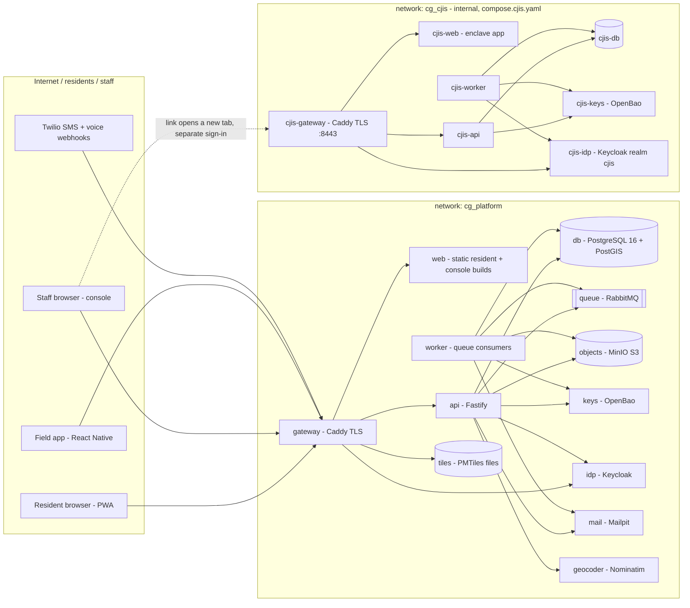

# Architecture

Status: proposed for review (first deliverable, 2026-10-12). Every technology named here has a decision record in [`docs/adr/`](adr/). Requirement IDs follow [`requirements-index.md`](requirements-index.md); namespaced IDs (`BRD:`, `DCL:`, `FL:`) are explained there (finding C-01).

## 1. Principles that shape everything

| Principle                         | Where it comes from                        | What it means in the design                                                                                                                                                                      |
| --------------------------------- | ------------------------------------------ | ------------------------------------------------------------------------------------------------------------------------------------------------------------------------------------------------ |
| A resident submission never fails | SCL-03, SCL-06, FR-00.04, CLAUDE.md rule 8 | Intake writes go to a durable queue, not straight into the main tables. The client keeps an outbox and shows "Not sent yet" until the server confirms.                                           |
| People decide, AI assists         | AIG-_, AI-_, RULE-13, PHO-11               | AI sits behind interfaces, returns suggestions in fixed schemas and holds no credentials. Consequential changes run through the same action catalog as manual ones.                              |
| Default deny, everywhere          | FR-00.01, SEC-06, ADM-05                   | One server-side policy engine decides every read, write and export, with hard guardrails ahead of county-configured roles. Postgres row-level security is the backstop.                          |
| Portable from day one             | SCL-11                                     | Every cloud dependency is behind an adapter with a local stand-in. Configuration only from environment variables and secrets. The same images run on Docker Desktop and in the government cloud. |
| The CJIS enclave is separate      | SEC-12, SCL-12                             | Its own containers, network, database, keys, identity and audit. Criminal-justice data never passes through the main platform.                                                                   |
| Synthetic data only               | SCL-12                                     | The seed generator builds a fictional county. There is no import path for production data on a laptop.                                                                                           |

## 2. Containers



### 2.1 Main platform (`compose.yaml`)

| Service              | Image                                               | Role                                                                                                                                                                                                                                | Health check                                                            |
| -------------------- | --------------------------------------------------- | ----------------------------------------------------------------------------------------------------------------------------------------------------------------------------------------------------------------------------------- | ----------------------------------------------------------------------- |
| `gateway`            | `caddy`                                             | TLS on `https://localhost` with Caddy's local CA (SEC-10 in transit). Routes `/` → resident app, `/console` → console, `/api` → api, `/auth` → Keycloak, `/tiles` → PMTiles files. Security headers (HSTS, CSP).                    | `GET /healthz`                                                          |
| `web`                | built from `apps/web-resident` + `apps/web-console` | Static, versioned builds of the two web apps. Separate from the API, so intake pages stay up when the API is degraded (SCL-06).                                                                                                     | `GET /healthz`                                                          |
| `api`                | built from `services/api`                           | Every HTTP endpoint: public intake, OTP lookup, published resources, staff console API, field-app sync API, Twilio webhooks. Stateless, scales horizontally.                                                                        | `/health/live`; `/health/ready` checks db, queue, objects, keys and idp |
| `worker`             | built from `services/worker` (same base as api)     | Queue consumers: intake persistence, photo processing, notifications, retention deletion, outbox relay, scheduled jobs. Scales separately from the API.                                                                             | `/health/live`, `/health/ready`                                         |
| `db`                 | `postgis/postgis`                                   | System of record. Separate logical databases for the platform and for Keycloak.                                                                                                                                                     | `pg_isready`                                                            |
| `queue`              | `rabbitmq` (management)                             | Durable quorum queues for intake and jobs. AMQP 0-9-1 runs unchanged on Amazon MQ for RabbitMQ in GovCloud.                                                                                                                         | `rabbitmq-diagnostics ping`                                             |
| `objects`            | MinIO                                               | Photos, documents, exports, official-report snapshots. Per-tenant prefixes and keys (SEC-05).                                                                                                                                       | `/minio/health/ready`                                                   |
| `keys` + `keys-init` | `openbao/openbao`                                   | Transit engine: per-tenant keys for envelope encryption (SEC-10). Secrets for local dev. `keys-init` initialises and unseals it on first run and stores the dev unseal key in a local volume. **Dev only**: the cloud uses its KMS. | `bao status`                                                            |
| `idp`                | `keycloak/keycloak`                                 | One realm per tenant: SSO brokering (SAML/OIDC) to the tenant's IdP, passkeys/WebAuthn MFA, local accounts as a last resort (finding G-01).                                                                                         | `/health/ready`                                                         |
| `mail`               | `axllent/mailpit`                                   | Local SMTP sink with a web UI. Stand-in for the email provider (finding Q-02).                                                                                                                                                      | `/livez`                                                                |
| `geocoder`           | `mediagis/nominatim` (profile `maps`)               | Self-hosted address search and reverse geocoding (SCL-13). First start imports the region extract.                                                                                                                                  | `/status`                                                               |
| `tiles-build`        | one-shot (profile `maps-build`)                     | Builds the region's vector tiles (PMTiles) from the OSM extract with Planetiler. Writes into the `tiles` volume served by the gateway.                                                                                              | exits 0                                                                 |

The CJIS set sits in its own compose file (`compose.cjis.yaml`), included by `compose.yaml` so one `docker compose up` starts both, but on its own internal network, volumes and secrets (ADR-0021).

### 2.2 CJIS enclave (`compose.cjis.yaml`, built in layer 5; ADR-0021, ADR-0036–0038)

| Service                        | Purpose                                                                                                                                                                                                                                                                                                                                                                 |
| ------------------------------ | ----------------------------------------------------------------------------------------------------------------------------------------------------------------------------------------------------------------------------------------------------------------------------------------------------------------------------------------------------------------------- |
| `cjis-gateway`                 | The enclave's only entry point, `https://localhost:8443` on the loopback address (its own local CA). Routes `/api` → `cjis-api`, `/auth` → `cjis-idp` (administration and master realm refused), everything else → `cjis-web`. On `cg_cjis` and the small edge network `cg_cjis_edge` that publishes its port. In the cloud, the enclave's own ingress with mutual TLS. |
| `cjis-web`                     | The enclave's own React app (`apps/web-cjis`): system use notification, sign-in, records, accounts and screening, approvals, audit review, retention (ADR-0038).                                                                                                                                                                                                        |
| `cjis-api`                     | Records for linked missions: people in law-enforcement roles, weapons, body-camera references, narratives, disposition and review (SEC-12, PPL-01); accounts, screening and roles; audit and retention. Database role `cjis_app`.                                                                                                                                       |
| `cjis-worker`                  | Same image as `cjis-api`, role `cjis_job`: the identity outbox, sign-in events into the audit, the retention sweep, 90-day inactivity suspension (ADR-0037).                                                                                                                                                                                                            |
| `cjis-migrate`                 | One-shot migrations of `packages/cjis-db`.                                                                                                                                                                                                                                                                                                                              |
| `cjis-provision`               | One-shot: realm `cjis` (flows, CJIS values, clients), per-agency keys, and on synthetic stacks only the exercise agencies, accounts and record (ADR-0036).                                                                                                                                                                                                              |
| `cjis-db`                      | Its own PostgreSQL instance and volume (databases `cjis` and `cjis_idp`). Not reachable from the platform network; no published port.                                                                                                                                                                                                                                   |
| `cjis-keys` + `cjis-keys-init` | Its own OpenBao transit engine; one key per agency. Keys never shared with the platform.                                                                                                                                                                                                                                                                                |
| `cjis-idp`                     | Its own Keycloak, realm `cjis`: password then passkey, the second factor proven in `amr`, lockout, idle limit and password policy per the CJIS values (ADR-0036).                                                                                                                                                                                                       |

**How the two halves meet.** The platform stores only an opaque `cji_ref` (random 256 bits) on a mission, set by a law-enforcement liaison. Holders of `mission.cji.open` see a link that opens the enclave's own address in a new tab, where they sign in separately; the enclave's app talks only to the enclave. CJI never passes through the platform's API, logs, queue or AI providers, and the two systems never call each other. Everyone else who can read the mission sees "Restricted: CJIS" and nothing else; phones, partners and the public see nothing (ADM-05 guardrail). The enclave holds **no real CJI** until it runs in an authorized government cloud and has passed the state CJIS audit (SCL-12); in production it refuses to start without that configuration.

### 2.3 Not containers

- `apps/field`: the React Native field app (layer 4). It talks to `api` through the gateway like any other client.
- Twilio: an external service, reached through the `comms` adapter. Local development uses a built-in simulator. Real webhooks reach a laptop only through a secured development tunnel (SCL-12).

## 3. Code layout (monorepo)

```
apps/
  web-resident/     React + Vite PWA (no install, EN/ES, <300 KB first load)
  web-console/      React + Vite staff console (role workspaces)
  field/            React Native (Expo) field app        — created in layer 4
services/
  api/              Fastify HTTP API
  worker/           queue consumers and scheduled jobs
  cjis-api/         enclave API                           — skeleton until layer 5
packages/
  config/           typed environment configuration (zod); PRODUCT_NAME lives here (ADM-03)
  contracts/        shared zod schemas: API payloads, question graph, action catalog
  db/               Kysely client, SQL migrations, RLS policies
  authz/            policy engine + guardrails (ADM-04/05)
  audit/            append-only, hash-chained audit writer and verifier
  adapters/         storage, keys, queue, idp, comms, email, ai, geocoder, routing
  i18n/             message catalogs (ICU), locale helpers, RTL support
  ui/               accessible React components shared by both web apps
  refdata/          reference data connectors, recorded responses, file import  — layer 6 (ADR-0039, ADR-0041)
  reporting/        the counting rule, declaration figures, report facts, FEMA package, metrics, equity — layer 6
  pdf/              tagged PDF/UA-1 writer                                      — layer 6 (ADR-0040)
tools/
  seed/             synthetic county generator (WESTWIND basis)
  reqindex/         requirements index generator
infra/              Dockerfiles, Caddyfile, Keycloak realm template, OpenBao init
docs/               requirements, architecture, ADRs, plans, traceability
```

## 4. Data model

All tables carry `tenant_id`, `created_at/by`, `updated_at/by` and a `version` integer for optimistic concurrency (FR-00.05). Every column is registered in a **data dictionary** with a classification (`public`, `internal`, `sensitive`, `restricted`, plus `cji` for enclave-only), per SEC-11. Classification drives:

- **Storage.** `restricted` columns are envelope-encrypted with the tenant's key (SEC-10): contact details, medical needs, household composition, free text.
- **Logging.** Classified values are redacted by the logger.
- **Export.** Restricted fields are left out unless the export grant names them.
- **AI context.** Restricted fields are left out or tokenized (AIG-05).

### 4.1 Tenancy and agreements (layer 1)

```
tenant(id, kind: state|region|county|city|partner_org, parent_id, path ltree,
       name, timezone, locales[], branding, status)
jurisdiction(tenant_id, geom multipolygon, fips)
license(tenant_id, tier, population_served, term_start, term_end, covers_tenant_ids[])   -- SCL-10
data_sharing_agreement(id, from_tenant, to_tenant, scope: deidentified_counts|consented_records|...,
       data_categories[], status, signed_at, version)                                   -- SCL-01, ADM-02
tenant_config(tenant_id, key, value jsonb, version)    -- question graphs, retention, planning factors (SCL-07)
```

The hierarchy is `state → region/coalition → county/city → partner organization` (SCL-01). Visibility never flows down the tree implicitly. Every cross-tenant read goes through a data-sharing agreement and the policy engine.

### 4.2 Events (layer 1)

```
event(id, tenant_id, name, hazard_type, template_id, status: draft|active|closed,
      opened_at, closed_at, intake_keywords[], intake_slug, footprint geom)            -- SCL-02
event_participant(event_id, tenant_id, role)    -- which tenants work this event
```

Reports, needs and missions link to one or more events (SCL-02). Missions exist only inside an active event (MIS-01).

### 4.3 People, accounts and permissions (layer 1)

```
account(id, idp_subject, email, status)           -- sign-in identity
personnel(id, tenant_id, name, agency, skills[], availability, duty_status, account_id NULL)
                                                  -- FR-01.05, ACCT-01: kept separate
role(id, tenant_id, name, template_key, version, status)
role_grant(role_id, action, scope: {org, event, geography, record_filter}, data_categories[])
role_assignment(account_id, role_id, scope, granted_by, approved_by, valid_from, valid_to)
permission_change_request(id, change jsonb, requested_by, approved_by, status)   -- second-admin rule
break_glass_session(id, account_id, reason, expires_at, notified_at)             -- SEC-08
```

### 4.4 Audit (layer 1)

```
audit_event(seq bigserial, tenant_id, occurred_at, recorded_at, actor_account_id, actor_kind,
            action, target_type, target_id, target_version, changes jsonb, execution_id,
            classification_read[], reason, prev_hash, hash)
```

- **Append-only.** The application's database role has `INSERT` and `SELECT` on `audit_event` only. There is no `UPDATE`, `DELETE` or `TRUNCATE`, and a trigger rejects them for every role except the migration owner (FR-08.04, ADM-05).
- **Tamper-evident.** `hash = sha256(prev_hash ‖ canonical(row))` per tenant chain. A verifier job re-walks the chain, and anchors are written periodically to object storage with object lock (SEC-18).
- **Coverage.** Every write, every read of restricted data, every export, every permission change and every AI action (SEC-18, CMD-37).

### 4.5 Intake, reports and review (layer 2)

```
intake_submission(execution_id PK, tenant_id, event_ids[], channel, received_at, payload_enc, status)
report(id, tenant_id, reference_code, channels_used[], question_graph_version,
       reporter_party_id, subject_party_id, helper_party_id,               -- D-02: helper ≠ subject
       is_own_home bool, location_id, answers jsonb, original_text_enc, original_lang,
       review_state: submitted|under_review|needs_information|approved|rejected|duplicate|superseded,
       verification_level: self_reported|desktop_verified|field_verified|cannot_verify,
       fema_degree NULL, fema_degree_set_by, duplicate_of, supersedes, version)
review_decision(report_id, report_version, reviewer, decision, reason, ai_suggestion_id NULL, agreed bool)
location(id, address components, unit, landmark, geom NULL, precision, source, parcel_id, usng)
photo(id, report_id, object_key, derivative_keys, exif_stripped bool, blur_status, uploaded_at)
party(id, tenant_id, kind: resident|helper|org, name_enc, contact_enc, language, consent_contact)
```

Review state and verification level are separate (S29.2). Only approved, verified records count in official totals.

### 4.6 Needs, consent and public information (layer 3)

```
need(id, report_id NULL, household_party_id, type, status, claimed_by_tenant, version)
consent(id, party_id, recipient_kind, granted_at, withdrawn_at, channel)              -- NED-03/05
need_share(need_id, partner_tenant_id, fields_shared[], dsa_id)                       -- NED-04
site(id, tenant_id, kind: shelter|feeding|pod|marc|..., status, capacity, census,
     confidential bool, reconfirmed_at, published_at, approved_by)                    -- PUB-01..06
resource(id, tenant_id, kind, title, body_i18n, review_date, expires_at, approved_by)
```

### 4.7 Missions, field and dispatch (layer 4)

```
mission(id, tenant_id, event_id, reference, kind, state: draft|open|en_route|on_scene|cleared|closed,
        priority, lock, cji_ref NULL, version)
assignment(id, mission_id, resource_kind: person|team|unit, resource_id, state, assigned_at, ...)
team / unit(id, tenant_id, kind, name, members)                                         -- DSP-02
check_in(id, personnel_id, event_id, team_id, started_at, ended_at, device_id)          -- FLD-03
position(check_in_id, at, geom, accuracy)    -- time-partitioned; 30-day retention (DSP-08)
hazard(id, mission_id NULL, kind, state: reported|confirmed|corrected|cleared, geom, restricted)
message(id, channel, recipients, body, state: queued|sent|delivered|acknowledged|failed, provider_evidence)
reminder(id, owner, due_at, state, linked_type, linked_id)                               -- F09
badge(id, personnel_id, state, code_hash, valid_to, revoked_at)                          -- F13
```

### 4.7a CJIS enclave (layer 5, `packages/cjis-db`, schema `cjis`, its own dictionary; ADR-0037)

```
agency(id, name, agency_identifier, platform_county, status, exercise)   -- the enclave's tenant; RLS forced per agency
agency_key(agency_id, version, wrapped, kek_name)           -- data key wrapped by the agency's transit key
person(id, agency_id, idp_subject, email, status, fingerprint_status, fingerprint_adjudicated_on,
       training_completed_on, training_expires_on, identity_state, last_seen_at, version)
                                                             -- screening as status and dates only
permission_request(id, person_id, role, change, requested_by, decided_by <> requested_by, status)
role_grant(person_id, role, status, request_id, granted_by, revoked_at)
record(id, agency_id, cji_ref, platform_mission_reference, platform_county, origin, classification,
       offense_codes, case_number_enc, summary_enc, state, disposition, disposition_by, reviewed_by, version)
record_person(role, name_enc, birth_date_enc, identifiers_enc, ...) -- PPL-01, BRD:FR-07.02
record_weapon(kind, description_enc, serial_enc, disposition)       -- BRD:FR-04.01
record_bodycam(camera_label, evidence_reference_enc, ...)            -- references only (BRD:FR-07.04)
record_event(record_id, at, kind, body_enc, by, amends)              -- append-only timeline (BRD:FR-07.01/07.03)
audit_event(seq, prev_hash, hash, ...), audit_review                 -- own chain, immutable (SEC-18)
retention_policy(agency_id, category, keep_days >= floor), legal_hold, deletion_log   -- SEC-13
identity_outbox, idp_event_cursor, idempotency_key(response_body_enc)
```

### 4.8 Official outputs (layer 6)

One counting rule (`packages/reporting/src/counting.ts`) decides what every official figure counts: approved and verified records only, one home one count (duplicates, field over desk, a building assessment absorbing its unit reports), per housing unit, with everything else shown apart rather than dropped (DCL:DEC-03/04). The Declaration screen, the metrics, official reports, the IDA package, the situation map's tracts and the PDA feature service all call it, so they cannot disagree (GATE-07; checked in `tests/integration/layer6.int.test.ts`).

```
refdata_snapshot / refdata_current / ref_tract, ref_tract_profile, ref_structure,
  ref_flood_zone, ref_facility, ref_declaration, ref_nfip_summary, ref_alert, ...  -- ADR-0039: pulled or imported, cited by snapshot (RULE-10)
location_geo(location_id, tract_geoid, tract_snapshot_id, jurisdiction_tenant_id)  -- DCL:DEC-05
declaration, outage, casualty_count (append-only), pa_site                          -- DCL:DEC-06–10, DEC-16
official_report, official_report_section, official_report_snapshot (frozen, hash),
  official_report_lock (object-locked copy in the records bucket)                   -- F15, RULE-10
fema_form_mapping(form, mapping_version, fema_form_version, fields, status)         -- DCL:DEC-12, DEC-15
export_file(kind ida_package|official_report, status, object_key, bytes, sha256,
  mappings, figures)                                                                -- DCL:DEC-11; built by the worker
package_photo (chosen, captioned, blurred derivatives only)                         -- DCL:DEC-13, PHO-07
joint_pda, joint_pda_stop, joint_pda_mark (insert-only)                             -- FL:FR-10
equity_alert (raised and cleared by the worker, acknowledged by staff)              -- EQ-11/12, CON-07
api_key (SHA-256 only), webhook (secret encrypted), webhook_delivery                -- SCL-09, ADR-0042
```

PDFs (the package, reports, metrics, the media sheet, the resident's own copy) are drawn by `packages/pdf` as PDF/UA-1 and checked by veraPDF in CI (ADR-0040). Exports are built by the worker from the outbox, at-least-once safe (each attempt its own object key, the first finished one recorded), stored in object storage and downloaded through the API with an audit row (SEC-18). The read-only feature service and signed webhooks are in ADR-0042.

### 4.9 Retention (layer 1 framework)

`retention_policy(tenant_id, data_category, keep_for)` defaults to 7 years (SEC-13). The exceptions are seeded: scribe audio on note confirmation, positions 30 days, personal command conversations 30 days. CJIS retention lives inside the enclave. `legal_hold(scope)` overrides deletion. A nightly worker job deletes data that has expired, and writes an audit event for each deletion batch.

Category sweeps (`services/worker/src/jobs/retention.ts`, daily) cover one-time codes, intake drafts, abuse signals, SMS and voice sessions, device commands, finished reminders and notices, checked-out child records, badges no longer valid, inactive partner contacts and resolved safety alerts. Each sweep deletes only finished rows past the tenant's period. It skips rows another record still points at, and it deletes a row's own history with it. A legal hold on the category, the record or its event keeps rows. Every batch is counted in `deletion_log` and audited. Tables that are otherwise append-only get a delete policy that only the worker role passes (migration 0077). Still open: the 7-year record categories (field records, communications, referrals, sharing, publications, core records and photos), pruning the field change feed (the field app would first need to re-download its area package when its cursor falls behind), and the public-records export that redacts restricted fields.

## 5. Adapters

Each adapter is a TypeScript interface in `packages/adapters`, with a local implementation used on Docker Desktop and a cloud implementation chosen by environment variables. Business code imports only the interface.

| Adapter                                        | Interface                                                                     | Local (Docker Desktop)                 | Government cloud                                             |
| ---------------------------------------------- | ----------------------------------------------------------------------------- | -------------------------------------- | ------------------------------------------------------------ |
| `storage`                                      | put/get/presign multipart/delete/lock                                         | MinIO via the S3 API                   | S3 (GovCloud) or any S3-compatible store                     |
| `keys`                                         | encrypt/decrypt data key per tenant, rotate                                   | OpenBao transit                        | AWS KMS / Azure Key Vault (FIPS 140-validated)               |
| `secrets`                                      | read secret                                                                   | env + OpenBao KV                       | Secrets Manager / Key Vault, injected as env                 |
| `queue`                                        | publish (with confirms), consume, dead-letter                                 | RabbitMQ                               | Amazon MQ for RabbitMQ (same protocol); SQS adapter possible |
| `idp`                                          | verify token, admin API for users/roles                                       | Keycloak                               | Keycloak in-cluster (same image)                             |
| `comms`                                        | sendSms, sendVoice, parse inbound webhook, status callback                    | Simulator + Twilio client (sandbox)    | Twilio (toll-free per county)                                |
| `email`                                        | send                                                                          | Mailpit SMTP                           | Provider chosen by Adam (Q-02), e.g. SES                     |
| `ai.llm`, `ai.stt`, `ai.translate`, `ai.image` | typed, schema-validated calls; every output records provider + model (AIG-12) | Deterministic fake provider            | Per-tenant provider that passes AIG-06 + AIG-08              |
| `ai.damage`                                    | classify(photo) → suggestion                                                  | Fake, **disabled by default** (PHO-12) | Validated partner model                                      |
| `geocoder`                                     | search, reverse                                                               | Nominatim                              | Same container                                               |
| `routing`                                      | travel time matrix, route                                                     | Straight-line fallback; Valhalla later | Same container (Q-03)                                        |
| `conditions`                                   | outages, road closures                                                        | File feeds                             | Utility/DOT feeds, Waze for Cities (Q-04)                    |

**Degradation (SCL-06).** Each adapter reports health. A `degradation` service turns features off in this order: AI → photo processing deferred → maps off → text intake only. The UI shows the mode honestly. Intake never depends on AI, photos or maps.

## 6. Permissions and guardrails

```
request ─▶ authenticate (Keycloak token, or public)
        ─▶ build subject: account, tenant, active role versions, scopes, CJIS-qualified flag, break-glass
        ─▶ policy.decide(subject, action, resource, fields)
              1. guardrails (code, not configurable)  → hard DENY
              2. tenant role grants (versioned config) → ALLOW with scope + field mask
              3. otherwise                             → DENY (default deny)
        ─▶ DB transaction: SET LOCAL app.tenant_id, app.account_id, app.scope
              Postgres RLS re-checks tenant isolation (backstop)
        ─▶ audit event (decision, fields read if restricted)
```

**Guardrails (ADM-05, coded in `packages/authz/guardrails.ts`, each with its own test file):**

1. Default deny; every check runs on the server. Prepared actions are rechecked when they execute (FR-00.01, AC-C05).
2. Public (unauthenticated) subjects can reach only: intake submission, published resources, and their own report after reference code + one-time code (FR-00.02, RULE-17).
3. CJI fields need an enclave session. The platform cannot even hold them (SEC-12): its dictionary guard refuses a column classified `cji`, it stores only the opaque `cji_ref`, and body-camera media is refused on missions. The enclave applies its own policy (`services/cjis-api/src/policy.ts`, E1–E6): default deny; CJIS-qualified for everything but one's own account; agency scope; audit immutable; a second administrator for roles and nobody administering their own account; nobody reviews their own disposition; no break-glass.
4. Nobody approves their own finding, unless the tenant policy grants an exception, and every exception is audited (FR-12.04, AC-12B).
5. No role can update or delete audit records. This is enforced by DB grants and a trigger, not only by the app (FR-08.04).
6. Granting permissions takes a second administrator: a `permission_change_request` executes only after another admin approves it.
7. Restricted health, counseling and legal fields are visible only to their roles (FL:FR-15, FL:FR-16, FL:FR-23), whatever a tenant configures.

**County configuration (ADM-04).** Roles are copied from shipped templates (the WESTWIND cast, the field and frontline roles, and the original A7 roles), then edited by action × record scope × data category. Every save creates a new role version and an audit event. "What can this role do" runs the policy engine against a synthetic subject and lists the allowed actions and visible fields before saving.

**Tenant isolation (SEC-05)** is proven by an automated cross-tenant test suite. For every table and every endpoint, a subject from tenant A gets nothing from tenant B. The suite runs both through the API and with direct SQL as the application role.

## 7. Intake write path (never fail)

1. The resident app generates an `execution_id` (UUID) when a draft starts. Answers live in an encrypted local outbox (IndexedDB) until confirmed.
2. On submit, `POST /api/public/submissions` with `Idempotency-Key: execution_id`. The API validates the shape only, encrypts restricted fields, and publishes to the `intake` quorum queue **with publisher confirms**.
3. Only after the broker confirms does the API return `202` with the **reference code**. Codes come from blocks of pre-generated, unique, random codes leased to each API instance, so no database round trip is needed (INT-22: 4 letters + 4 digits, no ambiguous characters).
4. If the queue is down, the API writes the submission to the `intake_submission` table instead (same idempotency key). If both are down, it returns an honest error. The client keeps the report and retries with backoff, showing "Not sent yet" (FR-00.04, CHN-07).
5. A worker consumes the message and upserts by `execution_id`, so a retry never makes a second report (AC-11B, FR-00.06). It creates the report, needs and consent records, and emits follow-up jobs: confirmation SMS/email, photo processing, duplicate check.
6. Photos upload straight to object storage with presigned multipart (resumable) URLs, separately from the submission. Processing (EXIF strip, blur, derivatives) is asynchronous (SCL-04, PHO-06/07).

SMS and IVR sessions run the same question graph (INT-01, CHN-01). The session state machine lives in the worker, keyed by phone number + event, with the same idempotency rules.

**Load target (SCL-03):** 50,000 submissions per hour (about 14 per second sustained, testing 2× bursts) and 10,000 concurrent SMS sessions. k6 scenarios are added in layer 2.

## 8. Field app offline sync (layer 4)

- **Local store.** SQLite encrypted with SQLCipher. The key is kept in the platform keystore (Keychain/Keystore) and unlocked with a PIN or biometrics (FLD-02).
- **Scope.** The device downloads only the volunteer's own assignments, their area's map package (a PMTiles extract cut by bounding box), parcels and job aids (FLD-13, FLD-14). Resident personal details are cleared after sync and at check-out.
- **Writes.** Every change is an action-catalog command with a client UUID, stored in an outbox and replayed in order. The server applies it with the same validation, authorization and idempotency as the console (NFR-11). The record shows "On this phone, not sent" until the server acknowledges it.
- **Reads.** A per-scope change feed with a server sequence cursor.
- **Conflicts.** Every record carries a `version`. A stale command gets a `409` with the server's current state, and the app asks the user to reconcile. Nothing is silently overwritten (FR-00.05, AC-00B). Append-only facts (service counts, photos, notes) never conflict.
- **Safety.** The help button and missed check-in timers queue and send the moment a network is available. When offline, the app says so plainly (FLD-16, DSP-07).
- **Device management.** Issued devices read managed app configuration (tenant URL, single-app mode). Remote wipe clears only the app's data (FLD-02).

## 9. Real-time updates

The console, dispatch board and needs board receive changes through **Server-Sent Events** from the API, fed by a RabbitMQ fan-out exchange. Freshness target ≤ 5 s (finding G-05). Every view shows "as of" times, and stale positions show their age (S29.2, FR-03.05).

## 10. Internationalization and accessibility

- Every resident and public string sits in ICU message catalogs (`packages/i18n`), English and Spanish at launch. A CI check fails on missing keys and on question text above grade 5 reading level (INT-08, measured per language).
- Layout uses CSS logical properties, and a pseudo-RTL locale runs in CI (EQ-09, finding C-08).
- `PRODUCT_NAME` comes from configuration and is never hardcoded (ADM-03). A CI grep fails the build if the literal product name appears in source outside config defaults. Resident SMS and calls use the county's name.
- WCAG 2.2 AA: shared accessible components (`packages/ui`), axe checks in Playwright for every screen, plus a manual checklist per screen (`docs/a11y/`).

## 11. Security baseline

- TLS at the gateway, HSTS, a strict CSP. In the cloud, TLS to the database, queue and object store, and mutual TLS between services.
- Field-level encryption for restricted columns using per-tenant data keys wrapped by the `keys` adapter. Encryption at rest for volumes is provided by the cloud provider (and FileVault/BitLocker on laptops).
- Secrets only from the environment or the secret store; `.env.example` holds placeholders, and real values are git-ignored. The logger redacts classified fields and known secret patterns.
- Abuse protection without CAPTCHAs (SEC-17): per-IP and per-phone rate limits, risk scoring, and SMS verification only when risk is high.
- CI: lint, typecheck, unit + integration tests, accessibility, Semgrep SAST, Trivy dependency and container scans, Syft SBOM, image signing on release (SEC-15).

## 12. Path from Docker Desktop to the government cloud

| Local (today)        | Government cloud (later)                                                                  | Change needed                            |
| -------------------- | ----------------------------------------------------------------------------------------- | ---------------------------------------- |
| `docker compose up`  | Kubernetes (EKS in AWS GovCloud, or AKS in Azure Government) via OpenTofu + Helm (SCL-07) | New IaC; same images                     |
| PostGIS container    | Amazon RDS for PostgreSQL with PostGIS (Multi-AZ)                                         | Connection env vars                      |
| RabbitMQ container   | Amazon MQ for RabbitMQ                                                                    | Connection env vars                      |
| MinIO                | S3 with object lock and per-tenant KMS keys                                               | Endpoint/credentials env vars            |
| OpenBao (dev unseal) | AWS KMS + Secrets Manager                                                                 | `KEYS_PROVIDER=aws-kms`                  |
| Keycloak container   | Same image, HA, external DB                                                               | Env vars                                 |
| Caddy local CA       | ALB + WAF + ACM certificates                                                              | Gateway replaced by the platform ingress |
| Mailpit              | Approved email provider                                                                   | `EMAIL_PROVIDER`                         |
| CJIS compose project | Separate account/subscription with its own network boundary, KMS and ingress (SEC-12)     | Separate deployment; same images         |
| Single node          | Multi-AZ + warm standby in a second US region, RPO ≤ 15 min, RTO ≤ 1 h (SCL-05)           | Proven only there (`Gov` in the index)   |

Nothing in application code changes for the move. Only environment variables, secrets and the infrastructure code do (SCL-11).
